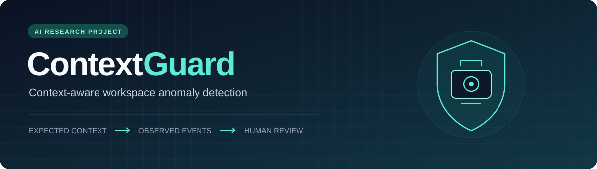
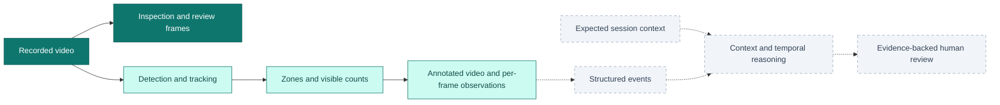

<div align="center">



**Understanding what happened starts with knowing what was expected.**

[](https://github.com/washam1337/ContextGuard/actions/workflows/tests.yml)


[Quick start](#quick-start) · [Current capabilities](#current-capabilities) · [Roadmap](#roadmap) · [Documentation](#documentation)

</div>

## Overview

ContextGuard is an AI final-year project at **FAST NUCES** exploring context-aware
anomaly detection in a controlled office. Its central research question is whether
comparing **expected activity with observed events over time** can produce more
useful, explainable alerts than isolated detections alone.

The initial scope is one fixed camera, one office, and two registered assets: a
laptop and a backpack. Planned scenarios cover excess simultaneous visitor
occupancy and observed asset departure inconsistent with session permissions.
Potential anomalies require human review; the system must not infer criminal intent.

> **Current phase: FYP-1 perception foundation.** Recorded-video inspection (CG-002)
> is complete. A combined perception pipeline (CG-003/004/005) is implemented:
> person, laptop and backpack detection, anonymous tracking, polygon zones and
> visible counts, producing an annotated video and structured per-frame output.
> It has been run on the team's consented, staged office recording (session S01:
> eight scenarios, 202 labelled seconds) with four pretrained models: people were
> counted exactly in 97.0–98.5% of labelled seconds, the laptop was found in
> 84.8–87.5% of visible seconds, and the backpack is the weak point (at most 33.8%).
> These are **development results on the same footage used for tuning**, not a
> held-out evaluation ([S01 results](docs/S01_RESULTS.md)). Context reasoning and
> anomaly decisions are planned; none of the system test cases SYS-01–SYS-08 has run.

## Current capabilities

| Capability | Status |
| --- | --- |
| Headless inspection of local recorded video | Implemented |
| Sequential decoded-frame counts and observed dimensions | Implemented |
| Reported metadata, timing limitations, and decode warnings | Implemented |
| First, middle, and last decoded-frame JPEG exports | Implemented |
| Versioned JSON inspection report | Implemented |
| Person, laptop and backpack detection (pretrained YOLO, CPU) | Partial: development results on S01 |
| Anonymous per-class tracking with observed vs predicted boxes | Partial: development results on S01 |
| Polygon zones, visible and per-zone counts | Partial: development results on S01 |
| Annotated video and versioned per-frame JSONL output | Partial: development results on S01 |
| Inferred room occupancy | Planned (always recorded as unknown for now) |
| Structured events and session permissions | Planned |
| Expected-versus-observed reasoning and evidence-backed review | Planned |
| Dashboard, feedback, and comparative evaluation | Planned |
| Audio and accessibility workflows | Deferred from the current build |

Both tools run on the CPU, open no GUI windows, process frames sequentially, and
refuse to overwrite existing output paths. Source recordings are never modified.

## Quick start

Use **Python 3.10** (the verified development version). Run these commands in a
terminal on Linux or macOS:

```bash
git clone https://github.com/washam1337/ContextGuard.git
cd ContextGuard
python3 -m venv .venv
source .venv/bin/activate
python -m pip install -r requirements.txt
```

On Windows, create the environment with `py -3.10 -m venv .venv` and activate it
with `.venv\Scripts\Activate.ps1` in PowerShell. The automated test suite currently
targets Linux.

Inspect a finished, stable recording, choosing an output directory that does not
already exist:

```bash
python scripts/inspect_video.py \
  --input /path/to/recording.mp4 \
  --output outputs/pilot-review-001
```

For CLI help:

```bash
python scripts/inspect_video.py --help
```

`requirements.txt` installs OpenCV plus CPU-only PyTorch and Ultralytics (about
1 GB). No GPU, camera connection or external service is required. Video codec
support depends on the local OpenCV build.

### Run the perception pipeline

The pipeline runs offline and never downloads weights by itself. Fetch a
pretrained model once, then check its SHA-256 against [docs/MODELS.md](docs/MODELS.md):

```bash
mkdir -p weights
python -c "from ultralytics import YOLO; YOLO('weights/yolo26n.pt')"
sha256sum weights/yolo26n.pt
```

Then process a recording into a new output directory:

```bash
python scripts/run_pipeline.py \
  --input /path/to/recording.mp4 \
  --output outputs/run-001 \
  --weights weights/yolo26n.pt
```

This writes `observations.jsonl` (one `contextguard.observation.v1` record per
frame), `annotated.mp4` and `manifest.json` (provenance and run summary). Add
`--zones <config.json>` for zone membership and per-zone counts. See the
[pipeline guide](docs/PIPELINE.md) for every option and output field.

### Output

For a recording with 12 successfully decoded frames, the output layout is:

```text
outputs/pilot-review-001/
├── inspection.json
├── frame_00000000.jpg
├── frame_00000005.jpg
└── frame_00000011.jpg
```

Short recordings may yield fewer than three distinct samples. The report uses
schema `contextguard.video_inspection.v1` and keeps container metadata separate
from decoded observations. See the [inspection guide](docs/VIDEO_INSPECTION.md)
for report fields, exit codes, and interpretation.

Review the JPEGs for doorway coverage, asset visibility, lighting, occlusion, and
object size. Also watch the source recording: three samples cannot establish
quality throughout a video. These exports are placement-review artifacts.

## How the project fits together



Dark nodes are implemented. Light teal nodes are implemented and validated only on
the S01 development footage. Dashed nodes are the planned research pipeline. The
complete workflow, with every module and its status, is in
[docs/WORKFLOW.md](docs/WORKFLOW.md). Observation,
inference, explanations, and human feedback remain separate design concerns. Missing detections or lost tracks alone must not be
treated as proof that an asset departed.

## Roadmap

- [x] Record the refined project scope and working decisions.
- [x] Build and test a recorded-video inspection utility.
- [x] Define the FYP-1 deliverables, milestones, and system test cases.
- [x] Build the combined perception pipeline (CG-003/004/005), tested on synthetic fixtures.
- [x] Run it on the consented staged office recording S01; compare four models; report development results.
- [ ] **CG-006** End-to-end recorded-video demo: annotated video plus structured output, with evaluation.
- [ ] Later: asset state, structured events, session permissions, and expected-versus-observed rules.
- [ ] Later: traceable evidence windows, human-review explanations, and stored feedback.
- [ ] Later: evaluate baselines, false positives, and the contribution of context.

The [FYP-1 scope amendment](MASTER_PLAN.md#fyp-1-scope-amendment--2026-10-24)
governs the current phase, building on the
[CG-002 scope amendment](MASTER_PLAN.md#scope-amendment-cg-002--2026-09-27). The
broader original specification is retained for traceability; learned temporal
modelling remains optional/proposed. Live status is in
[docs/CURRENT_STATE.md](docs/CURRENT_STATE.md).

## Development

With the environment activated, run the existing suite:

```bash
python -B -m unittest discover -s tests -v
```

Run it from the repository root. The 37 tests cover:

- the video inspector (10);
- zone geometry and configuration (8);
- observation records and the counting policy (5);
- per-class tracking with Ultralytics' ByteTrack (3);
- the end-to-end pipeline with a scripted detector (5);
- the S01 results scoring on hand-made fixtures (5);
- a real-model smoke test (1), which is skipped unless `weights/yolo26n.pt` is present.

Fixtures are generated in temporary storage and are **software test data, not a
research dataset**. GitHub Actions runs the same suite on Python 3.10 (without
weights).

```text
ContextGuard/
├── contextguard/              # Perception package: zones, tracking, observations, pipeline
├── scripts/                   # CLIs: inspect_video, run_pipeline, benchmark_models
├── configs/                   # Tracker settings and zone configurations
├── tests/                     # Unit and integration tests
├── docs/                      # Status, pipeline, models, dataset, decisions, history
├── weights/                   # Downloaded model weights (git-ignored)
├── CLAUDE.md                  # AI coding-agent instructions
├── .github/                   # CI and contribution templates
├── MASTER_PLAN.md             # Project specification and scope amendments
├── CONTRIBUTING.md            # Development and contribution guidance
├── LICENSE                    # GNU AGPL-3.0
└── requirements.txt           # Pinned runtime dependencies
```

## Documentation

| Document | Purpose |
| --- | --- |
| [Current state](docs/CURRENT_STATE.md) | Live status, open decisions, and next action |
| [Pipeline guide](docs/PIPELINE.md) | Running the pipeline, output schema, counting policy, limitations |
| [Models](docs/MODELS.md) | Dependencies, candidate weights with checksums, licences, benchmarks |
| [System workflow](docs/WORKFLOW.md) | Complete workflow diagram with the status of every module |
| [S01 results](docs/S01_RESULTS.md) | Development results for four models on the staged office footage |
| [S01 results plan](docs/S01_RESULTS_PLAN.md) | Labelling, matching and metric rules fixed before scoring |
| [SYS case status](docs/SYS_STATUS.md) | SYS-01–SYS-08: all planned / not run, with dependencies |
| [FYP-1 presentation guide](docs/PRESENTATION_FYP1.md) | Storyline, demo clips, numbers and wording for the presentation |
| [Dataset protocol](docs/dataset/README.md) | Recording protocol, consent and labelling templates |
| [Video inspection guide](docs/VIDEO_INSPECTION.md) | Report format, limitations, and troubleshooting |
| [Master plan](MASTER_PLAN.md) | Research direction and authoritative scope |
| [Working decisions](docs/DECISIONS.md) | Accepted scope refinements and pending decisions |
| [Progress](docs/PROGRESS.md) | Implementation status by component |
| [CG-002 handoff](docs/HANDOFF.md) | Historical CG-002 verification record |
| [Project history](docs/history/README.md) | Timeline and archived development sessions |
| [Agent instructions](CLAUDE.md) | Rules for AI-assisted development of this repository |
| [Contributing](CONTRIBUTING.md) | Local checks and contribution expectations |

## Research data and licensing

Recordings, generated reports and pipeline outputs, model weights, and local
credentials are excluded by repository ignore rules. Reports and manifests contain
the absolute source path, and annotated videos show people; review them before
sharing. The staged office dataset is collected with participant consent and is
never published in this repository.

ContextGuard is licensed under the [GNU Affero General Public License v3.0](LICENSE),
matching its Ultralytics dependency (AGPL-3.0). Pretrained weights are downloaded
separately and keep their own terms; see [docs/MODELS.md](docs/MODELS.md).
