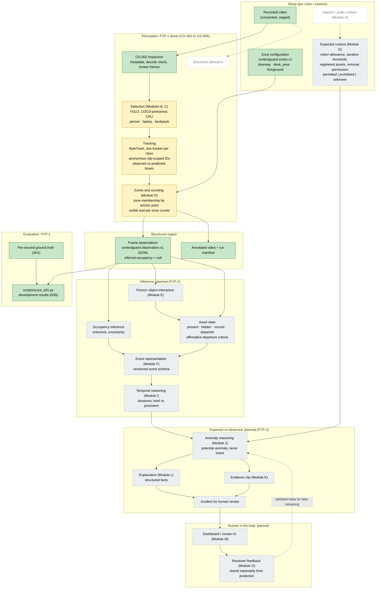

# ContextGuard system workflow (FYP-1 deliverable 1)

**Date:** 2026-11-23. This is the complete system workflow: what is built in FYP-1
and what is planned for later. Module letters refer to `MASTER_PLAN.md` § 7. Every
box carries its real status; nothing labelled PLANNED exists as code.

Status labels:
- **IMPLEMENTED:** built and tested.
- **PARTIAL:** built; validated only on S01 development data (D30).
- **PLANNED:** designed, not built.
- **DEFERRED / EXPERIMENTAL:** outside the FYP-1 demo.

## 1. Complete workflow

The solid green and yellow path is what runs today:

`recorded video → inspection → detection → tracking → zones/counting → observations JSONL + annotated video`.

Everything from **Inference** onward is the designed system that the FYP-1 output
feeds into; it is not implemented.

## 2. Stages, status and evidence

| Stage | Module | Status | Implementation / artifact | Evidence |
| --- | --- | --- | --- | --- |
| Recorded-video inspection | A | IMPLEMENTED | `scripts/inspect_video.py`, schema `contextguard.video_inspection.v1` | 10 tests; all 10 S01 clips inspected (PROGRESS 2026-11-21) |
| Person detection and tracking | B | PARTIAL | `contextguard/perception.py` (YOLO + class-wise ByteTrack) | S01: persons counted exactly in 97.0–98.5% of 202 labelled seconds ([S01_RESULTS.md](S01_RESULTS.md)) |
| Laptop / backpack detection | C | PARTIAL | same detector, COCO classes 63 / 24 | S01: laptop recall 84.8–87.5%; backpack ≤ 1% except yolo11s 33.8% |
| Zones and visible counts | D | PARTIAL | `contextguard/zones.py`, `configs/zones/S01_office_v1.json` (D33) | Deterministic tests; S01 zone timelines (S01_RESULTS § 4) |
| Frame observations | F (input) | IMPLEMENTED | `contextguard/observation.py`, `contextguard.observation.v1` | Schema validator and tests; 32 S01 runs |
| Annotated video, run manifest | (demo) | IMPLEMENTED | `contextguard/annotate.py`, `contextguard/pipeline.py` | Demo videos for S01 (outside the repo) |
| Development evaluation | (CG-006) | IMPLEMENTED for S01 | `scripts/score_s01.py`, [S01_RESULTS_PLAN.md](S01_RESULTS_PLAN.md) | 5 tests; [S01_RESULTS.md](S01_RESULTS.md) |
| Expected context (session rules, permissions) | G | PLANNED | — | — |
| Occupancy inference | (contract) | PLANNED | Field reserved: `inferred_occupancy` is always `null` | — |
| Person–object interaction, asset state | E | PLANNED | — | — |
| Event representation | F | PLANNED | — | — |
| Temporal reasoning (durations) | I | PLANNED | — | — |
| Anomaly reasoning, explanation, evidence | J, L, K | PLANNED | — | — |
| Dashboard, reviewer feedback | M, O | PLANNED | — | — |
| Speech/audio context | H | DEFERRED | — | — |
| Document detection | — | EXPERIMENTAL | Read-only check only (MODELS.md, D32) | — |

## 3. How the two target anomalies flow through the system

These walk-throughs show **where** each decision would be made. The perception
outputs exist and are measured on S01. The reasoning steps are **design**, not
built, and none of the SYS cases has run ([SYS_STATUS.md](SYS_STATUS.md)).

**A. Excess simultaneous visitors** (e.g. S01 SC03, SC04)

1. Perception (built): per frame, `visible_persons` and per-zone counts; people
   appear in `doorway` on arrival.
2. Occupancy inference (planned): turn visible counts plus entries and exits into
   an occupancy estimate with uncertainty. Visible ≠ occupancy.
3. Temporal reasoning (planned): exceedance must persist beyond the configured
   duration threshold. A brief exceedance stays distinguishable (SYS-07).
4. Context (planned): compare with the session's visitor allowance (SYS-01, SYS-02).
5. Output (planned): "potential anomaly: 2 visitors present for N s against an
   allowance of 1", with an evidence clip, for human review.

**B. Departure of a registered asset** (e.g. S01 SC05, SC06, SC08)

1. Perception (built): the laptop is detected in `desk_area`, then no longer
   detected.

   On S01 this signal is **identical** in three different situations:
   - hidden behind a person (SC06; it returns after about 6 s);
   - carried out of the door (SC05);
   - put on the PC tower (SC08; it stays in the room).
2. Asset state (planned): a missed detection or a lost track is **never** a departure.
   Departure needs affirmative evidence, for example: the asset is seen with a person,
   that person reaches the `doorway` and leaves, and the asset does not reappear.
3. Context (planned): the removal permission is `permitted | prohibited | unknown`;
   `unknown` is not authorisation (SYS-03, SYS-04, SYS-06). Occlusion must not
   confirm removal (SYS-05).
4. Output (planned): potential prohibited removal, with explanation and evidence clip,
   for human review. The reviewer's decision is stored separately (SYS-08).

## 4. Data contracts

| Contract | Version | Status |
| --- | --- | --- |
| Video inspection report | `contextguard.video_inspection.v1` | IMPLEMENTED |
| Zone configuration | `contextguard.zones.v1` | IMPLEMENTED |
| Frame observation (JSONL) | `contextguard.observation.v1` | IMPLEMENTED |
| Count policy | `contextguard.count_policy.v1` | IMPLEMENTED |
| Run manifest | `contextguard.run_manifest.v1` | IMPLEMENTED |
| Event / incident / feedback | not yet defined; will be separate, versioned schemas | PLANNED |
